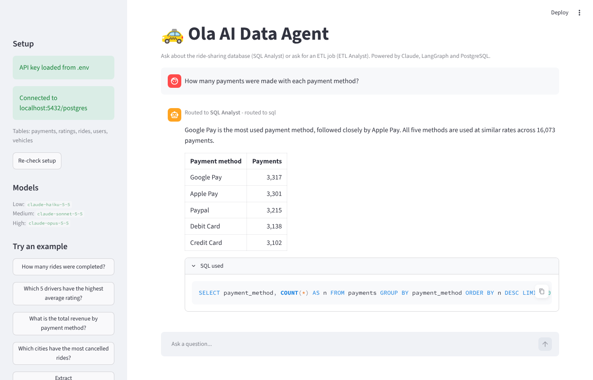
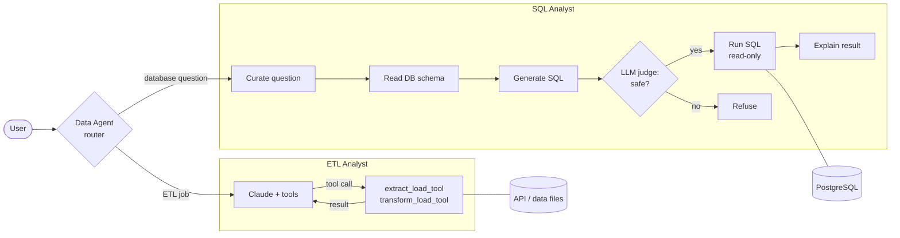

# 🚕 Ola AI Data Agent

**A multi-agent AI data assistant for a ride-sharing company, powered by Claude, LangGraph and PostgreSQL.**

Ask a question in plain English. A router agent decides whether it needs a database
query or an ETL job and hands it to the right specialist: the **SQL Analyst** writes,
safety-checks and runs SQL; the **ETL Analyst** pulls data from APIs and transforms
files with Pandas.



<sub>Screenshot from a test run: the numbers and SQL come from the sample database; the answer
wording was scripted. Replace `docs/screenshot.png` with your own once you've run it with your key.</sub>

## Highlights

- **Multi-agent orchestration** with LangGraph: a router plus two specialist sub-graphs
- **LLM-as-a-judge** safety check before any SQL runs, backed by a **read-only
  database transaction**, so a destructive query fails even if the judge misses it
- **ReAct agent with tools** for API extraction and Pandas transformations
- **Claude structured outputs** for routing and judging, using the native
  `json_schema` format that current Claude models require
- **Cost-aware model tiers**: Haiku for light work, Sonnet for SQL, Opus for code, all swappable in `.env`
- **Two interfaces**: a Streamlit web app and a terminal CLI
- **Friendly error handling** for missing or invalid keys, rate limits, network
  failures, empty replies and database outages
- **Tested**: 28 tests (Claude mocked, real PostgreSQL) run on every push with GitHub Actions

## How it works



| Step | Model tier (default) |
|---|---|
| Router, SQL generation, SQL judge | Medium: `claude-sonnet-5-5` |
| Curating the question, writing the final answer | Low: `claude-haiku-5-5` |
| ETL agent and the Pandas code it writes | High: `claude-opus-5-5` |

## Tech stack

Python 3.14 · Anthropic Claude API · LangGraph · LangChain · Pydantic · PostgreSQL ·
psycopg2 · Pandas · Streamlit · pytest · uv · GitHub Actions

---

## Getting started (Windows + VS Code)

### Prerequisites (one-time)

1. **PostgreSQL** installed and running (default port 5432).
2. **An Anthropic API key** from <https://console.anthropic.com>.
3. **uv**, the Python package manager. Run this once in PowerShell, then restart VS Code:

   ```powershell
   powershell -ExecutionPolicy ByPass -c "irm https://astral.sh/uv/install.ps1 | iex"
   ```

   You don't need to install Python: `uv` downloads Python 3.14 automatically.

### Setup

1. In VS Code: `File` -> `Open Folder...` -> select the `data-agent` folder.
2. `Terminal` -> `New Terminal`, then install everything:

   ```powershell
   uv sync
   ```

3. Open `.env` (create it from `.env.example` if you cloned the repo) and fill in:

   ```
   ANTHROPIC_API_KEY=sk-ant-...your key...
   DB_PASSWORD=1234
   ```

   Adjust the other `DB_` values if your PostgreSQL user, port or database differ.

4. Check the setup:

   ```powershell
   uv run data-agent --check
   ```

   Expected: `Setup OK: API key is set and PostgreSQL is reachable.`

5. **Only if your database is empty**, load the sample data (10,000 users, 20,000 rides, and more):

   ```powershell
   uv run data-agent-load-db
   ```

   It only fills empty tables. Add `--reset` to wipe and reload the five tables.

### Run the web app

```powershell
uv run streamlit run app.py
```

Open **<http://localhost:8501>** in your browser (it usually opens on its own).
Stop it with `Ctrl+C` in the terminal.

### Or run in the terminal

```powershell
uv run data-agent                                   # interactive chat
uv run data-agent "How many rides were completed?"  # one question
```

### Example questions

```
How many rides were completed?
Which 5 drivers have the highest average rating?
What is the total revenue by payment method?
Which cities have the most cancelled rides?
Extract https://pokeapi.co/api/v2/pokemon and save it to data/extract as csv
Transform data/extract/extracted_data.csv to keep only names starting with b and save it to data/transform as csv
```

### Using pip instead of uv

Requires Python 3.14 (`py -3.14 --version`).

```powershell
py -3.14 -m venv .venv
.venv\Scripts\Activate.ps1
pip install -r requirements.txt
pip install -e . --no-deps
streamlit run app.py
```

If `Activate.ps1` is blocked, run once: `Set-ExecutionPolicy -Scope CurrentUser RemoteSigned`

---

## Configuration

Secrets live in `.env`, which is git-ignored and never committed. Defaults live in `src/data_agent/config.py`.

| Variable | Default | Purpose |
|---|---|---|
| `ANTHROPIC_API_KEY` | *(required)* | Claude API key |
| `CLAUDE_MODEL_LOW` | `claude-haiku-5-5` | Question curation, final answers |
| `CLAUDE_MODEL_MEDIUM` | `claude-sonnet-5-5` | Router, SQL generation, SQL judge |
| `CLAUDE_MODEL_HIGH` | `claude-opus-5-5` | ETL agent and Pandas code (set to Sonnet to lower cost) |
| `DB_HOST` / `DB_PORT` | `localhost` / `5432` | PostgreSQL address |
| `DB_USER` / `DB_PASSWORD` / `DB_NAME` | `postgres` / *(empty)* / `postgres` | PostgreSQL login |
| `DB_SCHEMA` | `public` | Schema the SQL Analyst can see |

## Tests

```powershell
uv run pytest
```

The agent tests replace Claude with a scripted fake, so they're free and need no API
key. The database tests run against your PostgreSQL and skip themselves if it isn't
reachable. GitHub Actions (`.github/workflows/tests.yml`) runs the full suite against a
fresh PostgreSQL on every push.

## Project structure

```
data-agent/
├── app.py                    # Streamlit web app
├── main.py                   # terminal entry point (python main.py)
├── src/data_agent/
│   ├── config.py             # models, DB settings, paths
│   ├── llm.py                # Claude model factory
│   ├── errors.py             # user-friendly error messages
│   ├── schemas.py            # Pydantic graph state + structured outputs
│   ├── main.py               # CLI
│   ├── feed_db.py            # creates tables, loads sample CSVs
│   ├── agents/
│   │   ├── data_agent.py     # router graph
│   │   ├── sql_analyst.py    # SQL graph with LLM-as-a-judge
│   │   └── etl_analyst.py    # ReAct ETL graph + tools
│   └── utils/
│       ├── database.py       # read-only query execution
│       └── etl_tools.py      # extract / transform / execute helpers
├── tests/                    # pytest suite
├── data/                     # sample CSVs + ETL output folders
├── docs/screenshot.png
├── .github/workflows/tests.yml
├── .env.example              # copy to .env
├── pyproject.toml / uv.lock  # dependencies (uv)
└── requirements.txt          # dependencies (pip)
```

## Troubleshooting

| Message | Fix |
|---|---|
| `ANTHROPIC_API_KEY is missing...` | Add your key to `.env`, save, click **Re-check setup** in the app |
| `Anthropic rejected your API key` | Typo or revoked key; create a new one in the Console |
| `The Claude model was not found` | A `CLAUDE_MODEL_*` value in `.env` is wrong; clear it to use the default |
| `Anthropic rate limit reached` | Wait a minute; the SDK already retried twice |
| `Could not reach the Anthropic API` | Check internet, VPN or proxy |
| `Could not connect to PostgreSQL...` | Start PostgreSQL (Windows Services -> postgresql-x64-...) and check `DB_*` in `.env` |
| `No tables found` | Run `uv run data-agent-load-db` |
| `'uv' is not recognized` | Install uv (above) and restart VS Code |

## Security notes

- Your API key is only read on the server side (`.env` -> Python). It is never sent to the browser.
- SQL runs in a **read-only transaction** with a 15-second timeout.
- The ETL Analyst runs **Pandas code written by Claude on your machine**. Only use it with
  requests and data you trust, and don't expose this app to the internet as-is.

## Acknowledgements

Based on Ansh Lamba's [End-to-End Agentic AI Project](https://www.youtube.com/watch?v=7yOmi4IX-Rs)
([original repo](https://github.com/anshlambagit/AI_Data_Agent)). This version is rebuilt
to run only on the Anthropic Claude API and adds a Streamlit UI, read-only SQL execution,
structured-output fixes for current Claude models, error handling, tests and CI.

## License

[MIT](LICENSE)
